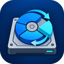

# Open Partition Manager



**Free, open-source partition manager for Windows Server and Azure VMs.** Move partitions out of
the way and extend C: (or any NTFS volume) into the free space, crash-safely, with a GUI and a
scriptable CLI. MIT licensed; no trial limits and no paid "Server edition".

It fixes the classic **"Extend Volume is greyed out"** problem in Disk Management: Windows can only
extend a volume into unallocated space *directly after it*. When a recovery partition, another
data partition or an MBR extended partition sits in the way, Open Partition Manager moves it
aside (keeping drive letters and volume GUIDs) so the volume can grow.

> **Status: preview.** The GUI and `opm` show disks, partitions, free space and everything the
> tool would refuse or warn about, and can move partitions (crash-safely, journaled) and extend
> volumes. Writes are limited to test virtual disks (VHD/VHDX) and, after a snapshot, real disks
> on Azure VMs; see the [compatibility matrix](#compatibility-matrix). See [`.spec/plan.md`](.spec/plan.md) for the
> plan and [`.spec/handover.md`](.spec/handover.md) for the original brief.

## A free alternative to commercial partition tools

Windows Server admins usually reach for paid tools to move a partition or extend the system
drive. Open Partition Manager is a free, open-source alternative to:

- AOMEI Partition Assistant (Server / Unlimited editions)
- MiniTool Partition Wizard (Server edition)
- EaseUS Partition Master (Server edition)
- Paragon Partition Manager / Hard Disk Manager for Server
- NIUBI Partition Editor (Server edition)
- IM-Magic Partition Resizer (Server edition)
- Macrorit Partition Expert (Server edition)

It also covers what Windows' own **Disk Management**, **diskpart** and **`Resize-Partition`**
can't do: move partitions, and grow an MBR extended partition so its last logical drive can be
extended. It currently moves and extends, and doesn't do everything those tools do yet
(shrink, clone, convert MBR↔GPT and moving the Windows partition are on the
[plan](.spec/plan.md)). Product names are trademarks of their owners; this project isn't
affiliated with any of them.

**Common searches this answers:** extend C drive on Windows Server · Extend Volume greyed out ·
unallocated space not next to C: · move recovery partition to extend C · resize partition on an
Azure VM · extend OS disk after resizing in the Azure portal · move partition Windows Server 2016 /
2019 / 2022 / 2025 · extend logical drive in an MBR extended partition · free partition manager
for Windows Server.

## Download

Everything is published from this repository; there is nothing else to install from.

- **Releases:** [Releases page](../../releases). Each version has
  `openpartition-<version>-win-x64.zip` and its `.sha256`. Unzip anywhere and run
  `OpenPartition.exe` (GUI) or `opm.exe` (CLI) from an elevated prompt. They're self-contained,
  so no .NET runtime or Visual C++ redistributable is needed.
- **Latest `main` build:** the rolling [`preview`](../../releases/tag/preview) pre-release,
  rebuilt by CI on every push to `main`. For testing only.

Check the download before running it:

```powershell
(Get-FileHash .\openpartition-0.1.0-win-x64.zip).Hash   # compare with the .sha256 file
```

The binaries are not code-signed yet, so Windows SmartScreen may warn the first time.

**No warranty.** This software is provided "as is" (see [LICENSE](LICENSE)). Partition changes
can destroy data. Always take a backup or snapshot first.

## Compatibility matrix

Last updated 2026-10-31. Only what has actually been run is marked as tested.

| Mark | Meaning |
|------|---------|
| ✅ | Tested and working |
| 🟡 | Expected to work, not tested yet |
| 🚧 | In progress |
| ⛔ | Refused by design: the tool will not do this, and says why |
| ❌ | Not supported yet |

### Where it can write

Reading is allowed everywhere. Writing is limited to the environments below, and is enforced by
the engine itself, not just the GUI.

| Environment | View disks | Change disks |
|-------------|:----------:|:------------:|
| Test virtual disks (VHD/VHDX attached on any machine) | ✅ | ✅ |
| Azure VM, after you name a snapshot of the disk | ✅ | 🟡 ready, first real-disk run pending |
| Hyper-V guest | 🟡 | ⛔ for now |
| Physical machine | ✅ | ⛔ for now |
| Other hypervisors (VMware, KVM, ...) | 🟡 | ⛔ for now |

### Windows versions

| Windows | View disks | Move partitions (tested on VHDX) | Notes |
|---------|:----------:|:--------------------------------:|-------|
| Windows Server 2016 (1607) | ✅ | ✅ | Azure field tests, including kill-and-recover and the MBR extended-partition round |
| Windows Server 2019 | 🟡 | 🟡 | |
| Windows Server 2022 | 🟡 | 🟡 | |
| Windows Server 2025 | 🟡 | 🟡 | |
| Windows 10 | 🟡 | 🟡 | |
| Windows 11 | ✅ | ✅ | Development machine; full harness |
| Server Core | 🟡 CLI only | 🟡 CLI only | The GUI needs the Desktop Experience |

### Disks and partitions

| Disk or partition | Move | Extend | Notes |
|-------------------|:----:|:------:|-------|
| GPT basic disk | ✅ | 🟡 | Volume GUID and drive letter kept |
| MBR basic disk, primary partition | ✅ | ✅ | Drive letter and volume GUID kept (MountedDevices updated) |
| MBR extended partition, with its logical drives | ✅ | ✅ | Moves as one block; every logical drive keeps its letter and GUID. Extend grows the container into free space after it (no data moves) |
| MBR logical drive on its own | ⛔ | ✅ last one only | Move the extended partition that holds it. Only the last logical drive can grow (into its container); grow the container first |
| 512-byte and 4K-native sectors (512n, 512e, 4Kn) | ✅ | 🟡 | |
| Partition followed by free space (e.g. C:) | | ✅ | Uses Windows' own resize, which is safe on a running system |
| Windows (boot) partition, C: | ⛔ | 🟡 | Can't be moved while Windows runs; it can be extended |
| System / EFI / MSR / recovery partitions | ⛔ | ⛔ | Never changed |
| Volume with a page file or hibernation file | ⛔ | 🟡 | Move the page file elsewhere first |
| BitLocker-encrypted volume | ⛔ | 🟡 | Decrypt before moving |
| Volume in use (open files, services) | ⛔ until released | ✅ | Never forced closed; stop whatever uses it. Remote Desktop drive redirection on the machine running the tool holds new drive letters open |
| Dynamic disks, Storage Spaces, Storage Replica, clustered disks | ⛔ | ⛔ | Use the native tools |

### Operations

| Operation | CLI | GUI |
|-----------|:---:|:---:|
| View disks, partitions, free space and refusal reasons | ✅ `opm` | ✅ |
| Move a partition (journaled, survives a crash or kill) | ✅ `opm move` | ✅ |
| Move an MBR extended partition with its logical drives | ✅ `opm move <disk> extended` | ✅ |
| Extend a volume into free space after it | ✅ `opm extend` | ✅ |
| Queue several operations, preview, then apply | ✅ `opm plan`, `opm apply` | ✅ |
| Resume an interrupted move | ✅ `opm resume` | 🟡 |
| Undo an interrupted move (if it never overwrote its original location) | ✅ `opm undo` | 🟡 |
| Stop and undo by itself if the data changes under a move | ✅ | ✅ |
| Copy only the space NTFS uses (free clusters are skipped) | ✅ | ✅ |
| Merge repeated moves or extends of the same partition in the plan | ✅ | ✅ |
| Shrink, create, delete, format | ❌ | ❌ |
| Move the Windows partition (boot-time mode) | ❌ | ❌ |

## Layout

| Path | What |
|------|------|
| `src/engine/` | Rust engine. `opm-core` is `no_std`: block device trait, crash-safety journal and the journaled block mover. `opm-platform-sim` is the simulated power-loss disk and crash campaign runner. `opm-platform-win32` does raw disk I/O, volume locking, partition table updates and MountedDevices fix-ups. `opm-engine-cli` is the `opm-engine` command. |
| `src/dotnet/` | .NET 10: model, read-only discovery, operations, Windows service (stub), `opm` CLI, WPF GUI (`OpenPartition.exe`). |
| `tests/dotnet/` | xUnit tests. |
| `tests/harness/` | PowerShell + Hyper-V harness: disk layout catalogue, VHDX builder with deterministic data and raw SHA-256 manifests, engine move scenarios, guest control, hard-stop fault injection. |
| `tools/package/` | Preview package and the on-machine self-test (`Test-OpmOnThisMachine.ps1`). |

## Building

Requirements: PowerShell 7.2+, .NET 10 SDK, Rust stable (MSVC) with clippy.

```powershell
./build.ps1                 # build everything, run all fast tests
./build.ps1 -Integration    # also build real VHDX disks (elevated session with Hyper-V)
```

## Releasing

CI (`.github/workflows/ci.yml`) builds, tests and packages every push and pull request. Pushes to
`main` also refresh the `preview` pre-release. To publish a version, bump `Version` in
`src/dotnet/OpenPartition.Model/ProductInfo.cs` (and `src/engine/Cargo.toml`), commit, then tag:

```powershell
git tag v0.1.0
git push origin v0.1.0     # CI checks the tag matches ProductInfo and publishes the release
```

## Using the preview

```powershell
opm list            # every disk, partition and free extent
opm show 2          # one disk in detail: GUIDs, attributes, BitLocker, every refusal
opm list --json     # machine-readable
opm move 0 extended --to end --snapshot my-snap      # dry run: shows the plan, changes nothing
opm move 0 extended --to end --snapshot my-snap --yes
opm extend 0 C: --snapshot my-snap --yes
opm resume --yes    # finish a move that was interrupted
opm undo --yes      # or put it back where it was (when the move never overwrote its source)
```

Run from an elevated prompt; without elevation BitLocker status is unknown and moves would be refused.

### Plans: several steps, previewed and applied together

The GUI's planned-changes queue, from the command line (Server Core included):

```powershell
opm plan new free-c.json
opm plan add free-c.json move 0 extended --to end
opm plan add free-c.json move 0 I: --to end
opm plan add free-c.json extend 0 C:            # --size max (the default) or a byte count
opm plan show free-c.json                        # dry run: the steps, each disk now and after
opm apply free-c.json --snapshot my-snap --yes [--json]
```

- Each `plan add` is checked against the disk as the earlier steps leave it (so `C:` can grow
  only once the moves before it have made room), and is merged like the GUI does: two moves
  of the same partition in a row become one move, a move back to where it started cancels
  out, and two extends become one. `@<offset>` means the partition's offset at that point in
  the plan.
- `opm apply` checks every step again against the live disks before anything is written. It
  refuses, without changing anything, if a disk is missing or its partitions changed since the
  plan was made (including by applying the plan once already). The write gate is the same as
  for `opm move`: test VHD/VHDX disks always, real disks only on an Azure VM with `--snapshot`.
  Without `--yes` it is a dry run.
- Steps run in order and the run stops at the first failure: the steps before it are complete,
  the rest are not started. Check with `opm show` (and `opm resume` if a move was interrupted),
  then make a new plan for what is left.

**Plan file format** (version 1). JSON, written by `opm plan`; edit it by hand only if you know
what you are doing, because `opm apply` re-checks it but can only apply what is in it.

```json
{
  "format": 1,
  "createdBy": "Open Partition Manager 0.1.0",
  "createdAt": "2026-10-31T12:00:00+00:00",
  "machine": "SERVER01",
  "disks": [
    { "number": 0, "diskId": "<GPT disk GUID or MBR signature, as in the engine journal>",
      "size": 274877906944, "fingerprint": "<SHA-256 of the partition layout>" }
  ],
  "steps": [
    { "kind": "move", "disk": 0, "what": "the extended partition", "from": 64961380352, "to": 204509413376, "length": 69805899776 },
    { "kind": "extend", "disk": 0, "what": "C:", "offset": 525336576, "oldSize": 53687091200, "newSize": 64424509440, "container": false }
  ]
}
```

- `format` is the file format version; a version of `opm` refuses formats it doesn't know.
- `disks` records each disk as it was when its first step was added: the ID the engine
  journals use, the size in bytes, and a fingerprint of its layout (style, size, sector size,
  usable area, and each partition's offset, size, type and GUID; not volume contents). Disks
  are found again by ID and size, so a disk renumbered after a reboot is still found.
- `steps` run in order. All values are bytes. `move`: the partition starting at `from` (of
  `length` bytes) moves to start at `to`. `extend`: the partition at `offset` grows from
  `oldSize` to `newSize`; `container: true` grows an MBR extended partition itself.

**`--json` progress.** `opm apply --json` writes one JSON object per line to standard output
and nothing else:

| `event` | Fields | When |
|---|---|---|
| `step` | `index`, `total`, `disk`, `description` | once per step, before anything runs |
| `gate` | `disk`, `verdict` (`Allowed`, `NeedsSnapshot`, `Refused`), `message` | once per disk |
| `dry-run` | `message` | no `--yes`: nothing was changed (last line) |
| `progress` | `index`, `total`, `fraction` (0 to 1, or `null`), `text` | while a step runs |
| `result` | `succeeded`, `completed`, `total`, `failedStep` (1-based, or `null`), `error` | after the run (last line) |
| `error` | `message` | refused before anything was written (last line) |

The exit code is 0 when the plan was applied (or the dry run passed) and 1 otherwise.

```json
{"event":"step","index":1,"total":3,"disk":2,"description":"Move the extended partition on disk 2 right by 447 MB (to 703 MB)"}
{"event":"gate","disk":2,"verdict":"Allowed","message":"Disk 2 is a test virtual disk."}
{"event":"progress","index":1,"total":3,"fraction":0.42,"text":"Copying"}
{"event":"result","succeeded":true,"completed":3,"total":3,"failedStep":null,"error":null}
```

To try the engine safely on any machine, run `Test-OpmOnThisMachine.ps1` from the preview
package. It builds throwaway VHDX disks, moves partitions on them, and deletes them afterwards.

## Contributing

Issues, compatibility reports and pull requests are welcome. Read [CONTRIBUTING.md](CONTRIBUTING.md) first: this tool writes raw disk sectors, so changes to how it writes need crash-campaign and VHDX tests. Report security problems privately ([SECURITY.md](SECURITY.md)). Everyone follows the [code of conduct](CODE_OF_CONDUCT.md).
